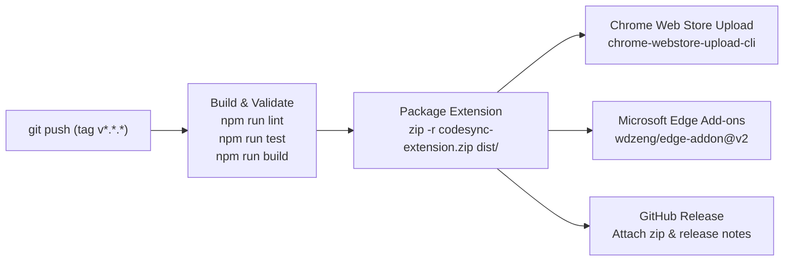

# CodeSync Build, Operations & Store Release Engineering

Use this skill when modifying Vite bundler configurations, service worker alarms, CI/CD workflows, or preparing a new release for the Chrome Web Store and Microsoft Edge Add-ons.

---

## 1. Vite Multi-Entry Bundling Architecture (`vite.config.ts`)

Chrome extensions require distinct entry points bundled to separate outputs:

```typescript
export default defineConfig(({ mode }) => {
  const isDev = mode === 'development';
  const enableLogs = process.env.VITE_ENABLE_LOGS === 'true' || isDev;

  return {
    esbuild: {
      // Automatically strip console statements in production builds
      drop: enableLogs ? [] : ['console', 'debugger'],
    },
    build: {
      outDir: 'dist',
      emptyOutDir: true,
      rollupOptions: {
        input: {
          popup: resolve(__dirname, 'src/popup/index.html'),
          options: resolve(__dirname, 'src/options/index.html'),
          background: resolve(__dirname, 'src/background/index.ts'),
          content: resolve(__dirname, 'src/content/index.ts'),
          interceptor: resolve(__dirname, 'src/content/interceptor.ts'),
        },
        output: {
          entryFileNames: (chunkInfo) => {
            if (['background', 'content', 'interceptor'].includes(chunkInfo.name)) {
              return '[name].js'; // Fixed names required by manifest.json
            }
            return 'assets/[name]-[hash].js';
          },
        },
      },
    },
  };
});
```

---

## 2. Service Worker Lifecycle & Alarms (`src/background/index.ts`)

In Manifest V3, service workers are ephemeral and terminate when idle. Persistent background timers must use the **Chrome Alarms API** rather than `setInterval`:

### Registered Alarms
1. **`process-queue-alarm`** (Period: 5 minutes):
   - Flushes pending submissions if `syncOnAccept` is true.
2. **`check-updates-alarm`** (Period: 60 minutes):
   - Invokes `chrome.runtime.requestUpdateCheck()`.
   - When an update is ready, `chrome.runtime.onUpdateAvailable` caches the new version number in storage so `UpdateBanner.tsx` displays the update notification.

### Stale Lock Recovery
Whenever the service worker wakes up (`onStartup`, `onInstalled`, or top-level module load), it immediately clears any stuck sync lock:
```typescript
if (typeof chrome !== 'undefined' && chrome.storage?.local) {
  chrome.storage.local.set({ codesync_is_syncing: false }).catch(() => {});
}
```

---

## 3. Automated CI/CD Release Pipeline (`.github/workflows/release.yml`)

The GitHub Actions workflow automates quality checks and multi-store deployment:



### Smart Whitelist Path Filtering
To avoid burning GitHub Actions runner minutes, the workflow triggers only on source changes (`src/**`, `public/**`, `package.json`, build configs), completely ignoring commits that touch only documentation or specs.

---

## 4. Release Checklist: Step-by-Step

When shipping a new version of CodeSync:

1. [ ] **Synchronize Version Numbers**:
   Ensure identical semantic versioning in:
   - `package.json`: `"version": "x.y.z"`
   - `public/manifest.json`: `"version": "x.y.z"`
2. [ ] **Verify Production Build**:
   ```bash
   npm run lint
   npm run test
   npm run build
   ```
3. [ ] **Test Minified Bundle in Chrome**:
   - Navigate to `chrome://extensions/`.
   - Click **Load unpacked** and select the `dist/` directory.
   - Verify popup renders, connects to GitHub, and console remains completely clean of debug logs.
4. [ ] **Commit & Push Git Tag**:
   ```bash
   git add package.json public/manifest.json
   git commit -m "chore(release): v1.2.2"
   git tag v1.2.2
   git push origin main --tags
   ```
   GitHub Actions will automatically build, package, and upload to both the Chrome Web Store and Microsoft Edge Add-ons Store.
