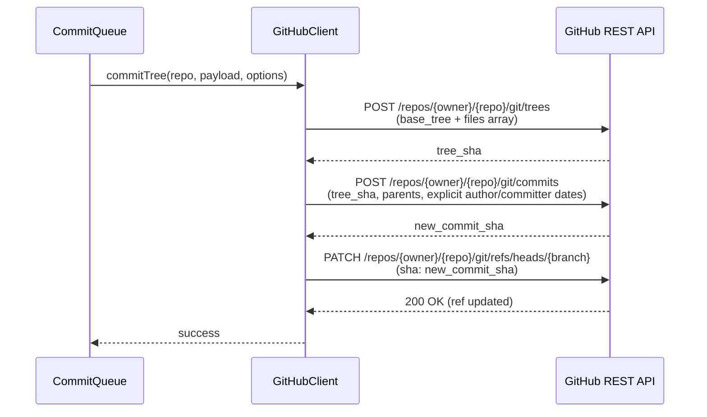

# CodeSync GitHub API & Git Trees Integration Guide

Use this skill when modifying GitHub API communication, commit generation, branch updating, or OAuth authentication in `src/github/`.

---

## 1. Atomic Multi-File Commits via Git Trees API

CodeSync never uses the single-file Contents API (`PUT /repos/contents`). Instead, it uses the low-level **Git Data API** to execute atomic multi-file commits:



### Git Tree Payload Construction
```typescript
const tree = files.map((file) => ({
  path: file.path,
  mode: '100644', // Standard file mode
  type: 'blob',
  content: file.content, // Inline content (< 100 KB) avoids creating separate blobs
}));

const treeRes = await this.request<{ sha: string }>(
  `/repos/${owner}/${repo}/git/trees`,
  {
    method: 'POST',
    body: JSON.stringify({ base_tree: baseTreeSha, tree }),
  }
);
```

---

## 2. Authentic Historical Timestamps Invariant

To accurately populate the user's GitHub contribution graph for historical solves, **BOTH** `author.date` and `committer.date` must be explicitly defined using the original solve timestamp:

```typescript
const isoDate = new Date(submission.timestamp).toISOString();

const commitPayload = {
  message: `[CodeSync] Solved: ${submission.problem.title} (${submission.language})`,
  tree: treeSha,
  parents: [parentCommitSha],
  author: {
    name: user.name || user.login,
    email: user.email || `${user.login}@users.noreply.github.com`,
    date: isoDate, // Explicit ISO 8601
  },
  committer: {
    name: user.name || user.login,
    email: user.email || `${user.login}@users.noreply.github.com`,
    date: isoDate, // Must match author.date
  },
};
```

---

## 3. High-Performance Batched GraphQL Sync Context

Rather than making 5 separate REST calls to retrieve the branch reference, parent commit SHA, base tree SHA, `README.md`, and `stats.json`, `GitHubClient.fetchSyncContext()` combines everything into a single GraphQL query:

```graphql
query getSyncContext($owner: String!, $name: String!, $branch: String!) {
  repository(owner: $owner, name: $name) {
    ref(qualifiedName: $branch) {
      target {
        oid
        ... on Commit {
          tree {
            oid
          }
        }
      }
    }
    readme: object(expression: "HEAD:README.md") {
      ... on Blob { text }
    }
    stats: object(expression: "HEAD:stats.json") {
      ... on Blob { text }
    }
  }
}
```

*Note: If the GraphQL endpoint returns errors (e.g. empty repository or missing scopes), the client transparently falls back to individual REST requests.*

---

## 4. Chained Commit SHAs & Race Condition Mitigation

When syncing multiple queued submissions sequentially, GitHub's internal database replicas experience brief propagation delays. Reading the head ref immediately after a commit often returns the *old* SHA, leading to HTTP 409 fast-forward conflicts.

**The Solution:**
CodeSync keeps the returned `commit_sha` in memory and passes it directly as the `parentCommitSha` for the next commit in the batch, completely bypassing ref polling during batch commits.

---

## 5. Zero-Client-Secret Universal OAuth Architecture

Extensions must **never** bundle the GitHub OAuth App Client Secret. CodeSync uses a serverless OAuth proxy (`codesync-oauth` deployed on Cloudflare Workers):

```
[Browser Extension]             [GitHub OAuth]             [Cloudflare OAuth Proxy]
       │                               │                              │
       │─── 1. chrome.identity ────────>                              │
       │    (launchWebAuthFlow)        │                              │
       │                               │                              │
       │─── 2. User Authorizes ────────>                              │
       │                               │                              │
       │<── 3. Redirect with ?code ────┘                              │
       │                                                              │
       │─── 4. POST /token { code, state } ───────────────────────────>
       │                                                              │─── 5. POST /login/oauth/access_token
       │                                                              │    (Injects Client Secret safely)
       │<── 6. Returns encrypted access_token ────────────────────────┘
```

---

## 6. Rate Limiting & Backoff Strategy

`GitHubClient` intercepts HTTP 429 and 403 rate-limit responses:
```typescript
if (response.status === 429 || response.status >= 500) {
  const retryAfter = response.headers.get('Retry-After');
  const delayMs = retryAfter ? parseInt(retryAfter, 10) * 1000 : (attempt + 1) * 1000;
  await this.sleep(delayMs);
  continue; // Retry with exponential delay
}
```
If primary rate limits are exhausted, `x-ratelimit-reset` is parsed to provide the user with the exact reset time.
