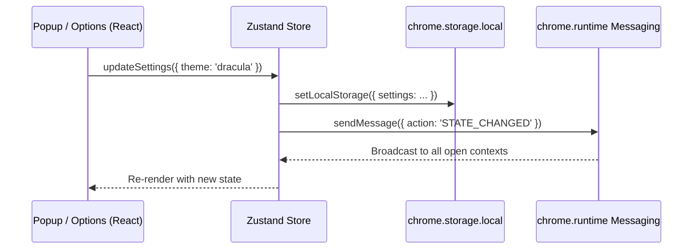

# CodeSync UI, Themes & Reactive State Architecture

Use this skill when developing or modifying popup components, the options page, the theme engine, or the Zustand store in `src/popup/`, `src/options/`, `src/store/`, and `src/styles/`.

---

## 1. Cross-Context Zustand State Synchronization

Because browser extension contexts (Popup UI, Options Page, Background Service Worker) run in completely separate JavaScript runtimes, state mutations must be synchronized across boundaries.



### Store Implementation Invariants (`src/store/index.ts`):
1. **Singleton Listener Guard**:
   Prevent multiple `chrome.runtime.onMessage` event listeners from stacking during hot module reloads:
   ```typescript
   let isListenerRegistered = false;
   if (!isListenerRegistered && typeof chrome !== 'undefined' && chrome.runtime?.onMessage) {
     isListenerRegistered = true;
     chrome.runtime.onMessage.addListener((message) => {
       if (message.action === 'STATE_UPDATED') {
         useAppStore.getState().initialize();
       }
     });
   }
   ```
2. **Asynchronous Initializer**:
   Every UI entrypoint (`Popup.tsx`, `Options.tsx`) calls `initialize()` on mount to load encrypted tokens and settings from storage.

---

## 2. Dynamic 15+ CSS Theme Engine (`src/styles/themes.ts`)

CodeSync features a variety of themes (including AMOLED, Dracula, Tokyo Night, Cyberpunk, Matrix, Nord, and Monokai).

### Theme Structure
Each theme is defined by a palette of CSS custom property tokens:
```typescript
export interface Theme {
  id: string;
  name: string;
  colors: {
    bgPrimary: string;
    bgSecondary: string;
    bgTertiary: string;
    textPrimary: string;
    textSecondary: string;
    accent: string;
    border: string;
    card: string;
  };
}
```

### Applying Themes:
Themes are applied to the root document element dynamically:
```typescript
export function applyTheme(themeId: string): void {
  const theme = getThemeById(themeId);
  const root = document.documentElement;
  Object.entries(theme.colors).forEach(([token, value]) => {
    root.style.setProperty(`--color-${token}`, value);
  });
}
```

In Tailwind, CSS variables are mapped via `tailwind.config.js`:
```javascript
theme: {
  extend: {
    colors: {
      bgPrimary: 'var(--color-bgPrimary)',
      accent: 'var(--color-accent)',
    }
  }
}
```

---

## 3. Modular Popup Component Hierarchy

The popup UI (`src/popup/Popup.tsx`) is decomposed into focused, single-responsibility components under `src/popup/components/`:

- **`Header.tsx`**: Displays logo, extension version, online status, and theme selector trigger.
- **`UpdateBanner.tsx`**: Renders when a new Chrome Web Store version has downloaded in the background; triggers one-click reload via `chrome.runtime.reload()`.
- **`UserProfileCard.tsx`**: Displays the authenticated GitHub user profile, avatar, and logout action.
- **`RepoSelector.tsx`**: Dropdown for selecting the destination GitHub repository, creating a new repo, and showing solved counts.
- **`SyncControl.tsx`**: Displays the pending commit queue count and provides the manual "Sync Now" trigger button.
- **`AuthForm.tsx`**: Renders GitHub OAuth button and fallback Personal Access Token (PAT) input.
- **`Footer.tsx`**: Navigation links to problem platforms, options page, and documentation.

---

## 4. Design Guidelines & Radix Primitives

1. **Accessibility First**:
   - Switches use `@radix-ui/react-switch` with associated `@radix-ui/react-label`.
   - Modals use accessible backdrop trapping and keyboard escape triggers (`ConfirmModal.tsx`).
2. **Compact Viewport Constraints**:
   - The Chrome extension popup width is fixed at `w-[360px]` to `w-[400px]` with a maximum height of `600px`.
   - Content that exceeds viewport height must use custom scrollbars (`overflow-y-auto`).
3. **No Heavy Icon Bundles**:
   - Icons are centralized in `src/popup/components/Icons.tsx` as lightweight, hand-crafted SVG components rather than importing massive full-library bundles (e.g. `lucide-react` or `react-icons`).

---

## 5. Testing UI State

Test cross-context state hydration and store actions using Vitest:
```bash
npm run test -- src/store/__tests__/stateSync.test.ts
```
